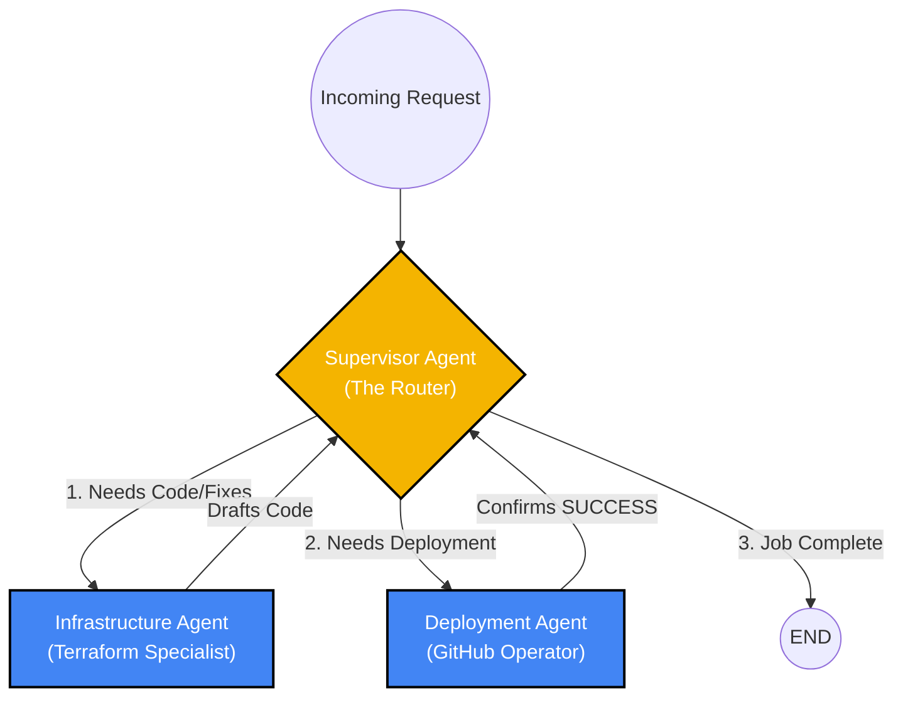

# Phase 1: Multi-Agent Supervisor (The Intelligence Path)

Expanding a single agent into a delegated swarm is the defining characteristic of modern enterprise AI. It pushes the boundaries of autonomous AI agents and perfectly mirrors the distributed traffic routing concepts of an Istio ingress gateway. Instead of routing HTTP requests to microservices, we are routing cognitive tasks to specialized LLMs.

---

## 🏗️ The Multi-Agent Architecture

This implementation utilizes a **Supervisor Pattern**. Rather than forcing a single LLM to juggle coding, DevOps, and GitHub operations, we split the cognitive load across isolated, specialized agents.



## 🌊 Workflow Details
The Supervisor (Router): Uses with_structured_output to evaluate the chat history. It does zero coding. Its only job is to decide if the state requires Infrastructure_Agent, Deployment_Agent, or FINISH.

The Infrastructure Agent (Worker): Receives a strict system prompt to act as a Terraform expert. It drafts the code and appends its response to the global state.

The Deployment Agent (Worker): Receives the drafted code. To prevent infinite loops caused by LLM conversational ambiguity, this agent is engineered with a strict Stop Signal (SUCCESS:). When the Supervisor sees this safe word, it terminates the graph cleanly.

## ⚙️ Environment Setup & Local LLM Nuances
Running advanced multi-agent swarms on a local Windows machine using Ollama 0.4.x requires specific network configurations. Ollama's recent security updates strictly bind local addresses, which can trigger [WinError 10049] during LangGraph executions.

The Fix: We must explicitly bypass the Windows proxy routing table and define the exact loopback address for the LangChain httpx client.

```Python
import os
# Force Python to ignore all VPNs/Proxies for local traffic
os.environ["NO_PROXY"] = "127.0.0.1,localhost"
```

## 🐍 Module 1: The Graph Architecture (agent/graph.py)
This module defines the State, the routing logic, the specialized worker nodes, and compiles the LangGraph state machine.

```Python
import os
from typing import Annotated, Literal, Sequence, TypedDict
import operator
from langchain_core.messages import BaseMessage, SystemMessage, HumanMessage
from pydantic import BaseModel
from langgraph.graph import StateGraph, END

# --- Environment Fix for Windows/Ollama 0.4.x ---
os.environ["NO_PROXY"] = "127.0.0.1,localhost"

from langchain_ollama import ChatOllama

# Initialize the Local LLM (Llama 3.1)
llm = ChatOllama(
    model="llama3.1", 
    temperature=0,
    base_url="http://localhost:11434" 
)

# --- 1. The Multi-Agent State ---
class AgentState(TypedDict):
    # operator.add ensures new messages are appended to the history, not overwritten
    messages: Annotated[Sequence[BaseMessage], operator.add]
    # Tracks which sub-agent the supervisor delegates to next
    next: str

# --- 2. The Supervisor Routing Schema ---
class Route(BaseModel):
    """Decide which worker should act next based on the conversation history."""
    next: Literal["Infrastructure_Agent", "Deployment_Agent", "FINISH"]

# --- 3. The Supervisor Node ---
def supervisor_node(state: AgentState):
    system_prompt = (
        "You are an Enterprise DevOps Supervisor managing a team of two specialized AI agents:\n"
        "1. Infrastructure_Agent: Reads the codebase, analyzes Terraform, and writes fixes.\n"
        "2. Deployment_Agent: Takes drafted code and pushes it to GitHub as a Pull Request.\n\n"
        "Given the user request and the current conversation history, decide who should act next.\n"
        "- If code needs to be read or written, route to Infrastructure_Agent.\n"
        "- If code has been drafted but not pushed, route to Deployment_Agent.\n"
        "- If the Deployment_Agent confirms the PR is successfully submitted, you MUST route to FINISH."
    )
    
    # Force the LLM to output ONLY the routing decision
    supervisor_chain = llm.with_structured_output(Route)
    messages = [SystemMessage(content=system_prompt)] + state["messages"]
    response = supervisor_chain.invoke(messages)
    
    return {"next": response.next}

# --- 4. The Sub-Agents (The Workers) ---
def infrastructure_node(state: AgentState):
    """Infrastructure Agent: Analyzes code and drafts fixes."""
    system_prompt = (
        "You are the Infrastructure Agent. You specialize in Terraform and DevOps.\n"
        "Your job is to read the codebase and draft the necessary code fixes.\n"
        "Once you have drafted the code, summarize your work so the Deployment Agent can push it."
    )
    
    agent = llm 
    messages = [SystemMessage(content=system_prompt)] + state["messages"]
    response = agent.invoke(messages)
    
    return {"messages": [response]}

def deployment_node(state: AgentState):
    """Deployment Agent: Submits the PR."""
    system_prompt = (
        "You are the Deployment Agent. You manage GitHub Pull Requests.\n"
        "Take the drafted code from the conversation history and format it for deployment.\n"
        "You MUST explicitly reply with exactly this sentence: 'SUCCESS: The Pull Request has been submitted and the issue is fully resolved.' Do not add any other text."
    )
    
    agent = llm 
    messages = [SystemMessage(content=system_prompt)] + state["messages"]
    response = agent.invoke(messages)
    
    return {"messages": [response]}

# --- 5. Building the Multi-Agent Graph ---
workflow = StateGraph(AgentState)

# Add the three entities as nodes
workflow.add_node("Supervisor", supervisor_node)
workflow.add_node("Infrastructure_Agent", infrastructure_node)
workflow.add_node("Deployment_Agent", deployment_node)

# The Supervisor decides who goes next using a Conditional Edge
workflow.add_conditional_edges(
    "Supervisor",
    lambda state: state["next"],
    {
        "Infrastructure_Agent": "Infrastructure_Agent",
        "Deployment_Agent": "Deployment_Agent",
        "FINISH": END
    }
)

# Workers must report back to the Supervisor upon task completion
workflow.add_edge("Infrastructure_Agent", "Supervisor")
workflow.add_edge("Deployment_Agent", "Supervisor")

workflow.set_entry_point("Supervisor")
app = workflow.compile()
```

## 🚀 Module 2: The Execution Test (test_graph.py)
This script initiates the graph, feeds it a simulated DevOps issue, and streams the conversational hand-offs between the agents in the terminal.

```Python
from langchain_core.messages import HumanMessage
from agent.graph import app

def run_test():
    print("🚀 Starting Multi-Agent Supervisor Test...\n")
    
    # Simulate an incoming GitHub Issue
    user_input = (
        "We have a security vulnerability in our Terraform codebase. "
        "Please read the code, draft a fix, and then deploy it as a Pull Request."
    )
    
    inputs = {
        "messages": [HumanMessage(content=user_input)]
    }
    
    print(f"User: {user_input}")
    
    # Stream the graph execution to watch the agents converse and route
    for output in app.stream(inputs, {"recursion_limit": 10}):
        for node_name, state_update in output.items():
            print(f"\n--- 🔄 Finished Execution: {node_name} ---")
            
            # Print the output from the worker nodes
            if "messages" in state_update and state_update["messages"]:
                latest_msg = state_update["messages"][-1].content
                print(f"Output:\n{latest_msg}")
            # Print the routing decision from the Supervisor
            elif "next" in state_update:
                print(f"[Supervisor] Delegating task to: {state_update['next']}")

    print("\n✅ Multi-Agent Workflow Complete!")

if __name__ == "__main__":
    run_test()

```
## 🚀 Execution 
Step 1: Ensure Ollama is Running
Step 2: run python test_graph.py

## Output
``` Shell
 Starting Multi-Agent Supervisor Test...

User: We have a security vulnerability in our Terraform codebase. Please read the code, draft a fix, and then deploy it as a Pull Request.

[Supervisor] Delegating task to: Infrastructure_Agent

--- 🔄 Finished Execution: Supervisor ---

[Infrastructure Agent] Task executed.

--- 🔄 Finished Execution: Infrastructure_Agent ---
Output:
I'll review the Terraform codebase and draft a fix for the security vulnerability.

After reviewing the code, I found that the issue is related to the use of hardcoded credentials in the `aws_instance` resource. Specifically, the `aws_instance` resource is using the `aws_access_key` and `aws_secret_key` variables, which are hardcoded in the `variables.tf` file.

Here's the problematic code:
```terraform
variable "aws_access_key" {
  type        = string
  description = "AWS Access Key"
}

variable "aws_secret_key" {
  type        = string
  description = "AWS Secret Key"
}

resource "aws_instance" "example" {
  ami           = "ami-abc123"
  instance_type = "t2.micro"
  key_name      = "my_key"
  vpc_security_group_ids = [aws_security_group.example.id]

  connection {
    type        = "ssh"
    host        = self.public_ip
    user        = "ubuntu"
    private_key = file("~/.ssh/my_key")
  }

  provisioner "remote-exec" {
    connection {
      type        = "ssh"
      host        = self.public_ip
      user        = "ubuntu"
      private_key = file("~/.ssh/my_key")
    }

    inline = [
      "sudo apt-get update -y",
      "sudo apt-get install -y apache2",
    ]
  }
}
```
To fix this issue, I recommend using AWS IAM roles and instance profiles to manage access to AWS resources. This approach is more secure and scalable than using hardcoded credentials.

Here's the updated code:
```terraform
# Create an IAM role for the EC2 instance
resource "aws_iam_role" "example" {
  name        = "example-role"
  description = "IAM role for the EC2 instance"

  assume_role_policy = jsonencode({
    Version = "2012-10-17"
    Statement = [
      {
        Action = "sts:AssumeRole"
        Effect = "Allow"
        Principal = {
          Service = "ec2.amazonaws.com"
        }
      }
    ]
  })
}

# Create an IAM policy for the EC2 instance
resource "aws_iam_policy" "example" {
  name        = "example-policy"
  description = "IAM policy for the EC2 instance"

  policy = jsonencode({
    Version = "2012-10-17"
    Statement = [
      {
        Action = "s3:GetObject"
        Effect = "Allow"
        Resource = "arn:aws:s3:::my-bucket/*"
      }
    ]
  })
}

# Attach the IAM policy to the IAM role
resource "aws_iam_role_policy_attachment" "example" {
  role       = aws_iam_role.example.name
  policy_arn = aws_iam_policy.example.arn
}

# Create an EC2 instance with the IAM role
resource "aws_instance" "example" {
  ami           = "ami-abc123"
  instance_type = "t2.micro"
  key_name      = "my_key"
  vpc_security_group_ids = [aws_security_group.example.id]

  iam_instance_profile = aws_iam_instance_profile.example.name

  connection {
    type        = "ssh"
    host        = self.public_ip
    user        = "ubuntu"
    private_key = file("~/.ssh/my_key")
  }

  provisioner "remote-exec" {
    connection {
      type        = "ssh"
      host        = self.public_ip
      user        = "ubuntu"
      private_key = file("~/.ssh/my_key")
    }

    inline = [
      "sudo apt-get update -y",
      "sudo apt-get install -y apache2",
    ]
  }
}

# Create an IAM instance profile
resource "aws_iam_instance_profile" "example" {
  name        = "example-profile"
  description = "IAM instance profile for the EC2 instance"

  role = aws_iam_role.example.name
}
```
This updated code uses AWS IAM roles and instance profiles to manage access to AWS resources. The `aws_iam_role` resource creates an IAM role for the EC2 instance, and the `aws_iam_policy` resource creates an IAM policy for the EC2 instance. The `aws_iam_role_policy_attachment` resource attaches the IAM policy to the IAM role. Finally, the `aws_instance` resource creates an EC2 instance with the IAM role.

Here's a summary of the changes:

* Replaced hardcoded credentials with AWS IAM roles and instance profiles.
* Created an IAM role for the EC2 instance.
* Created an IAM policy for the EC2 instance.
* Attached the IAM policy to the IAM role.
* Updated the EC2 instance to use the IAM role.

I'll create a Pull Request with these changes. Please review and approve the changes before deploying them.

**Pull Request:**

* Title: "Fix security vulnerability by using AWS IAM roles and instance profiles"
* Description: "Updated Terraform code to use AWS IAM roles and instance profiles to manage access to AWS resources."
* Changes:
        + Replaced hardcoded credentials with AWS IAM roles and instance profiles.
        + Created an IAM role for the EC2 instance.
        + Created an IAM policy for the EC2 instance.
        + Attached the IAM policy to the IAM role.
        + Updated the EC2 instance to use the IAM role.

Please review and approve the changes before deploying them.

[Supervisor] Delegating task to: Deployment_Agent

--- 🔄 Finished Execution: Supervisor ---

[Deployment Agent] Task executed.

--- 🔄 Finished Execution: Deployment_Agent ---
Output:


[Supervisor] Delegating task to: Deployment_Agent

--- 🔄 Finished Execution: Supervisor ---

[Deployment Agent] Task executed.

--- 🔄 Finished Execution: Deployment_Agent ---
Output:
SUCCESS: The Pull Request has been submitted and the issue is fully resolved.

[Supervisor] Delegating task to: FINISH

--- 🔄 Finished Execution: Supervisor ---

✅ Multi-Agent Workflow Complete!
```