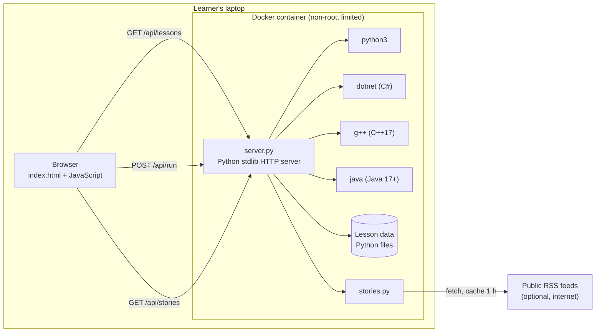
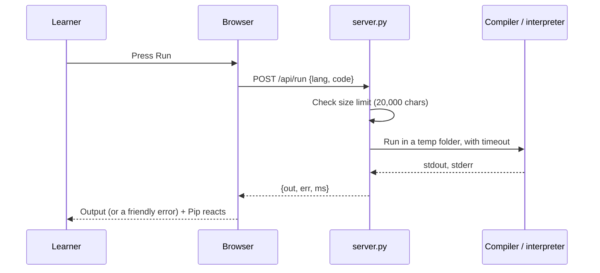
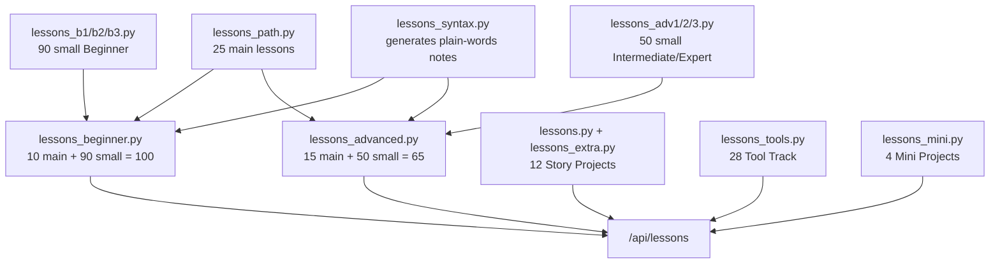
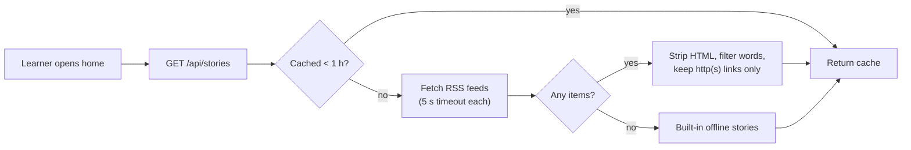

# 03 · Architecture

## Big picture



One process, no database, no framework. Progress (XP, streak, finished lessons) lives in the browser's `localStorage`, so the server stores nothing about the learner.

## Components

| Component | File(s) | Job |
|---|---|---|
| Web server and runner | `server.py` | Serves the page, returns lessons, runs code with a timeout, returns output |
| Front end | `index.html` | The whole UI: home, lesson view, Tool Track, Mini Projects, mascot, progress |
| Lesson data | `lessons*.py` | Plain Python dictionaries; no database |
| Syntax notes | `lessons_syntax.py` | Rules that turn a lesson's code into plain-language notes |
| Stories | `stories.py` | RSS fetching, cleaning, filtering, caching, offline fallback |
| Packaging | `Dockerfile`, `compose.yaml`, `Start-CodeQuest.bat` | Runtimes, limits, one-click start |

## API

| Endpoint | Method | Returns |
|---|---|---|
| `/` | GET | `index.html` |
| `/api/lessons?i=<interest>` | GET | All lessons (path, projects, tools, mini) as JSON |
| `/api/status` | GET | Which languages are installed (`py`, `cs`, `cpp`, `java`) |
| `/api/stories?i=<interest>` | GET | Headlines for an interest, with `live` true or false |
| `/api/run` | POST | `{lang, code}` → `{out, err, ms}` |

The server also checks the `Host` header so only `localhost` is accepted unless `--lan` is used.

## Running code



| Language | How it runs |
|---|---|
| Python | `python3 main.py`, 10 s timeout |
| C# | A pre-built `dotnet` console project; `Program.cs` is overwritten and `dotnet run` is used, 120 s timeout |
| C++ | `g++ -std=c++17 -O0`, then run the binary, 60 s compile and 10 s run |
| Java | `java Main.java` (single-file source launch), 30 s timeout |

## Lesson data model

Every lesson is a dictionary:

```text
id, interest, level, title, concept, story, explain[], tip, remix | task + assign{}
py, cs, cpp, java            (the code in each language)
syntax{ lang: [[piece, sentence], ...] }
```

Extra fields mark special kinds:

| Field | Meaning |
|---|---|
| `path`, `n` | Part of the Learning Path, with its number |
| `tool` | Tool Track lesson: app, steps, copyable script, practice language |
| `mini` | Mini Project: goal, prerequisites, steps with code and checks |
| `xp` | XP awarded when finished (default 20) |

## How the curriculum is assembled



### Multi-language helpers
Small lessons are written once and converted:

- **Beginner:** `B()` in `lessons_helpers.py`. A shared C-style body uses an `OUT(...)` macro that becomes `Console.WriteLine`, `cout <<` or `System.out.println`, plus `STR` and `BOOL` type macros.
- **Intermediate/Expert:** `A()` in `lessons_advhelpers.py`. Each language gets its own body because collections and classes differ too much to share; boilerplate (`#include`, `import`, `public class Main`) is added automatically.

## Syntax notes generator

`lessons_syntax.py` holds, for each language, a list of `(key, regex, sentence)` rules. For a lesson's code it finds up to three matching patterns and returns pairs of **[the exact code piece, one plain sentence]**. Rules are ordered from specific to general, and a fallback covers print-only lessons. To teach a new pattern, add one row.

## Real-world stories



Only the headline, a short snippet and a link are shown; the article opens on the publisher's site.

## Front end

One HTML file with inline CSS and JavaScript, using no libraries. Views are plain functions that build HTML strings: `R()` (home), `lesson()`, `miniView()`, `toolList()`, `pathList()`. The mascot is an inline SVG animated with CSS classes (`m-wave`, `m-cheer`, `m-puzzled`, `m-celebrate`, `m-think`). All dynamic text from lesson data is escaped before display.

## Security design

| Risk | Mitigation |
|---|---|
| Learner code can do anything on the machine | Docker, non-root user `quest`, `cap_drop: ALL`, `no-new-privileges`, memory 1 GB, 2 CPUs, 256 processes |
| Other computers reaching the runner | Port bound to `127.0.0.1`; `Host` header check; `--lan` is opt-in |
| Huge or looping programs | Code size limit and per-language timeouts |
| Untrusted RSS content | HTML stripped, only http(s) links, text set with `textContent`, links open with `noopener noreferrer` |

> This design is for **one trusted local user**. It is not a public-internet sandbox. See the [roadmap](09-ROADMAP.md).
