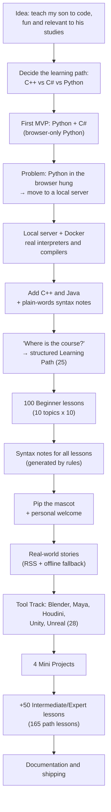

# 07 · Build journey

How Code Quest grew from a one-line idea to a platform, and what was learned on the way. Useful if you want to understand why things are the way they are.

## Timeline

## Key decisions

| Decision | Why |
|---|---|
| **Teach all four languages** (Python, C#, C++, Java) | He can compare them; C# fits Unity, C++ fits Unreal, Python fits Blender, Maya and Houdini |
| **Interest-first design** | His motivation is animation and film, so assignments change with his interest instead of using generic "bank account" examples |
| **Local-first, not cloud** | Real compilers and interpreters, no per-use cost, no safety risk from running strangers' code, works offline |
| **Docker** | One command, same everywhere, and a safer place to run learner code |
| **Vanilla JS, one HTML file, stdlib Python** | The builder is not a web developer: nothing to install, nothing to build, easy to read |
| **Generated syntax notes** | 165 lessons × 4 languages of hand-written notes would drift out of sync; rules stay consistent |
| **Same output in every language** | Makes lessons comparable and makes testing automatic |
| **Tool Track as copy-paste scripts** | The 3D apps cannot run inside a browser container, so each lesson has a runnable practice version plus a script for the real app |
| **Original mascot** | Avoids copying a known character; the SVG is easy to swap for his own artwork |
| **Hosting deferred** | Needs a real sandbox for running code online; local use covers the real need today |

## Problems found and how they were fixed

| Problem | Fix |
|---|---|
| Python in the browser hung on "Loading Python…" | Moved to a local server that uses the laptop's real interpreters |
| "Where are the 12 Beginner lessons?": they were 3 per interest, not a course | Built a proper Learning Path (25), then expanded Beginner to 100 |
| New lessons did not appear after copying files | The old `server.py` and `index.html` were still running; updating those fixed it |
| A file the builder had added was overwritten by mistake | Rewrote the replacement to keep the interface the server expects, and reported it openly. **Lesson: read an existing file before replacing it** |
| Java cannot index strings with `[0]` | Used `charAt(0)` in a Java-specific variant |
| C++ `round` not declared | Added the `<cmath>` header |
| C++ evaluation order printed text before an error was thrown | Compute the value first, then print |
| Print-only lessons had too few syntax notes | Added rules and a fallback sentence |
| "Picked up JAVA_TOOL_OPTIONS" appeared as output | It is a harmless message from the JVM; ignored in tests |

## Working method that paid off

1. **Build in batches and test each batch.** Beginner lessons came in three batches of 30; Intermediate and Expert in three batches too.
2. **Automate the cross-language check.** A small script runs each lesson's Python, C++ and Java version and compares the output. It caught real bugs (indexing, includes, evaluation order).
3. **Generate what can be generated.** Syntax notes, assignments and numbering are computed, not typed.
4. **Be honest about what is untested.** C# and the 3D-app scripts could not be run in the build environment (see [Quality](08-QUALITY-AND-LIMITS.md)).
5. **Keep the learner in mind.** Short lessons, friendly errors, a mascot, no punishment for missing a day.

## What I would do differently

- Read the existing project files at the start of every session before touching them.
- Set up the cross-language test script on day one.
- Agree the lesson structure (course, not a handful of examples) before writing content.
