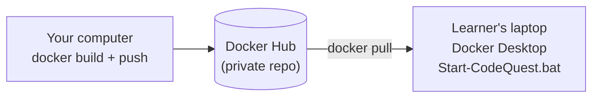

# 10 · Publish the image and deploy to the learner's laptop

Goal: build once, push the image to a registry, and let the learner run it with no build and no source code on his laptop.



## 1. Build for the right CPU

His laptop is a normal Windows PC (**amd64**). If you build on an Apple Silicon Mac the image would be arm64 and fail on his laptop, so always build for amd64:

```bash
docker buildx build --platform linux/amd64 -t YOUR_DOCKERHUB_USER/codequest:1.0 -t YOUR_DOCKERHUB_USER/codequest:latest --push .
```

On a Windows or Intel machine, the simple way works too:

```bash
docker build -t YOUR_DOCKERHUB_USER/codequest:1.0 -t YOUR_DOCKERHUB_USER/codequest:latest .
docker push YOUR_DOCKERHUB_USER/codequest:1.0
docker push YOUR_DOCKERHUB_USER/codequest:latest
```

## 2. Docker Hub setup (once)

1. Create a free account at https://hub.docker.com.
2. **Create repository** → name `codequest` → visibility **Private** (the free plan includes one private repository).
3. **Account settings > Personal access tokens > Generate**: give it a name like `codequest-pull`, permission **Read-only** (for the learner), and copy the token. Create a second token with **Read & Write** for yourself.
4. On your computer: `docker login -u YOUR_DOCKERHUB_USER` and paste your read/write token.

Public or private?

| | Public | Private |
|---|---|---|
| Learner needs to sign in | No | Yes, once, with the read-only token |
| Anyone can download the lessons | Yes | No |
| Good for | Sharing with other learners | Just your family |

## 3. Give the learner his folder

Send him the `son-laptop` folder (zip it). It contains:

| File | Purpose |
|---|---|
| `compose.yaml` | Pulls your image and applies the safety limits |
| `Start-CodeQuest.bat` | Starts it and opens the browser |
| `Stop-CodeQuest.bat` | Stops it |
| `Update-CodeQuest.bat` | Downloads the newest version |
| `READ-ME-FIRST.md` | Step-by-step setup for him |

**Before zipping:** open `compose.yaml` and `READ-ME-FIRST.md` and replace `YOUR_DOCKERHUB_USER` with your username.

## 4. Test it as him

On a clean machine (or after `docker rmi YOUR_DOCKERHUB_USER/codequest:latest`):

```bash
docker login -u YOUR_DOCKERHUB_USER      # private repo only
docker compose up -d
```

Open http://localhost:8000, run one lesson in each of the four languages, and check the Tool Track and Mini Projects open.

## 5. Updating later

1. Change the lessons.
2. Build and push a new version (increase the number: `1.1`, `1.2`) and `latest`.
3. He double-clicks **Update-CodeQuest.bat**. His progress is kept because it lives in his browser.

## Alternatives

| Option | Notes |
|---|---|
| **GitHub Container Registry (ghcr.io)** | Free private images with your GitHub account. Tag `ghcr.io/YOUR_GITHUB_USER/codequest:latest`, log in with a personal access token that has `read:packages` / `write:packages`. |
| **Azure Container Registry** | Good if you move to Azure later, but it has a monthly cost. |
| **No registry** | `docker save` and `docker load` with a file (see [05](05-SETUP-AND-DEPLOYMENT.md)). Fine for a one-off copy. |

## Checklist

- [ ] Built for `linux/amd64`
- [ ] Repository is private (unless you want it public)
- [ ] Image tagged with a version and `latest`
- [ ] Read-only token created for the learner
- [ ] `YOUR_DOCKERHUB_USER` replaced in `compose.yaml` and `READ-ME-FIRST.md`
- [ ] Tested pull and run on a clean setup
- [ ] No secrets in the image (there are none: no accounts, no keys)
