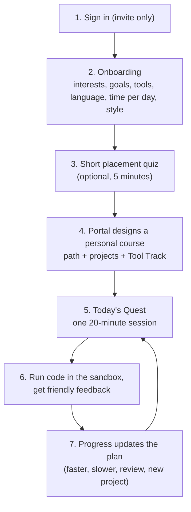
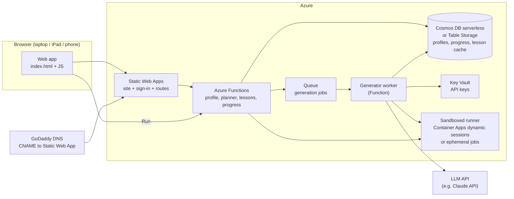
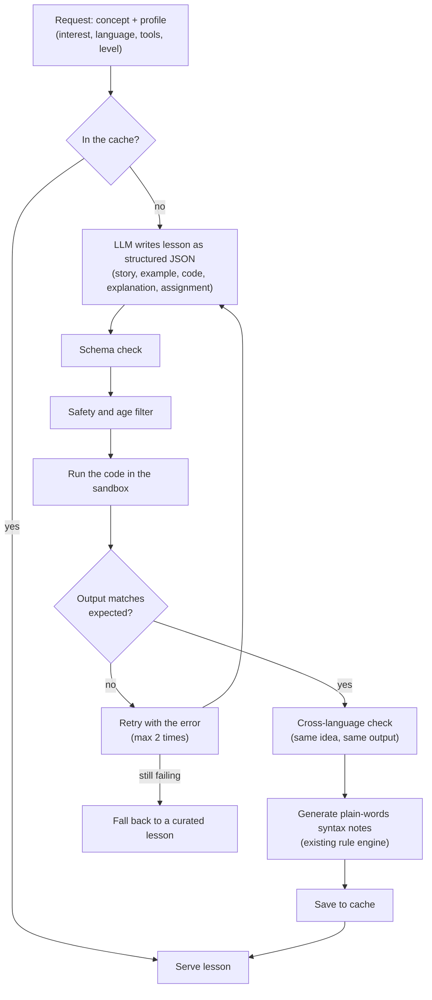

# 11 · Online version: a personalised learning portal (design)

> **Status:** design proposal. Nothing here is built yet. It replaces the earlier idea of "just host the same app online" in [09 · Roadmap](09-ROADMAP.md).

## 1. Vision

The local app teaches one fixed course, with the assignments re-themed for four interests. The online version should do much more:

> **Every learner tells the portal who he is, what he loves and what tools he uses, and the portal designs his own Learning Path, projects, Tool Track and stories, in the language he picks.**

A 14-year-old who loves Minecraft mods and a film student who loves colour grading should not see the same course. Both still need loops, functions and classes, but their examples, projects, tools and order should differ.

## 2. Assumptions (please confirm or change)

| Topic | Assumption used in this design |
|---|---|
| Users | Invite-only: the learner plus a few friends or family (about 5–10 accounts), not public sign-up |
| Azure budget | Up to about **$10–25 per month** for hosting, with a hard budget alert |
| AI budget | Separate, small and capped per day (see section 8) |
| Languages | Python, C#, C++ and Java, as today |
| Devices | Any browser: laptop, iPad, phone |
| Local app | Stays as the free, offline, always-working version |

## 3. Design principle: a fixed skeleton, a personalised skin

Letting an AI invent a whole curriculum is risky: it can skip essential ideas, order topics badly, or produce code that does not run. The safe and effective design is a hybrid:

| Layer | Who decides | Example |
|---|---|---|
| **Concept graph** (what must be learned, and in what order of dependency) | Curated by us | variables → conditions → loops → lists → functions → classes |
| **Path selection and order** (which concepts, how fast, how many practice items) | A rule-based planner from the learner's profile and progress | Skip printing basics if the placement quiz is strong; add extra loop practice if he struggles |
| **Surface content** (examples, stories, assignments, projects, Tool Track scripts) | AI-generated, **then verified by running the code** | "Loop through the bones of your dragon rig" instead of a generic list |
| **Correctness and safety** | Automatic checks plus a content filter | Python, C++ and Java must print identical output; no unsafe or adult content |

This keeps the pedagogy trustworthy while making everything feel personal.

## 4. What the learner experiences

### Onboarding questions

| Question | Why it matters |
|---|---|
| What do you love making or watching? (free text plus tags: games, 3D, VFX, film, music, robots, fashion, sport…) | Themes every example, story and project |
| What do you want to be able to do in a year? | Chooses the capstone project |
| Which tools do you use or want to use? (Blender, Maya, Houdini, Unity, Unreal, Premiere, DaVinci Resolve, Excel…) | Builds the Tool Track |
| Language to learn first | Python, C#, C++ or Java; others can be added later |
| Experience (never / a little / comfortable) and a placement quiz | Starting point |
| Minutes per day and days per week | Session length and pacing, with a forgiving streak |
| How do you like to learn? (watch and copy, read, puzzles, build projects, challenges) | Mix of lesson types |

### Example: two learners, same concept

| Concept: **loops** | Learner A: loves Minecraft mods (Java) | Learner B: film student using Blender (Python) |
|---|---|---|
| Example | Place 5 blocks in a row with a `for` loop | Place 5 cubes along the x axis |
| Assignment | Build a staircase of 10 blocks | Make a spiral staircase of 24 steps |
| Tool Track | Minecraft/Java mod setup | Blender `bpy` script |
| Capstone | A simple mod that spawns coins | A rendered bouncing-ball scene |

## 5. System architecture

| Piece | Service | Notes |
|---|---|---|
| Front end and sign-in | **Azure Static Web Apps** (free tier) | Built-in auth with invites; custom domain via a CNAME at GoDaddy |
| API | **Azure Functions** (consumption) | Profile, planner, lesson delivery, run requests, progress |
| Data | **Cosmos DB serverless** or **Table Storage** | Table Storage is the cheapest; Cosmos is easier to query |
| Generation | Queue + worker Function | Lessons are generated ahead of time, not while the learner waits |
| Code runner | **Azure Container Apps dynamic sessions** (custom container) or short-lived jobs | Isolated per run, no network, strict limits. Check current availability and pricing. |
| AI | LLM API key in **Key Vault** | Called only by the generator worker, never by the browser |
| Monitoring | Application Insights + budget alerts | Alerts on cost, errors and abuse |

## 6. The content pipeline: generate, verify, cache

AI output is never shown to the learner until it passes automatic checks.

Key points:

- **Structured output**: the model returns JSON in our lesson format, not free text.
- **Verification by running**: code that does not compile or does not print the expected result is rejected. This is the same cross-language check that built the current 165 lessons.
- **Fallback**: if generation fails, serve the curated lesson. The learner never sees a broken lesson.
- **Shared cache**: lessons are cached by `concept + interest + language + level`. Learners with the same combination reuse content, which keeps the AI cost small.
- **Syntax notes** keep using the existing rule engine, so they are consistent.

### What gets generated

| Output | Generated from | Verified by |
|---|---|---|
| Personal Learning Path (order and pacing) | Concept graph + profile + progress (rules, not AI) | Unit tests on the planner |
| Lesson examples and assignments | LLM from concept + interest + language | Run in sandbox, filter |
| Projects and capstone | LLM from interest + goal + tools | Step code run in sandbox; steps validated |
| Tool Track scripts (Blender, Unity…) | LLM from tool + concept + language | Syntax check and, where possible, a stub test; flagged "unverified in app" until tested |
| Stories | Live RSS plus an LLM "coder angle" tied to the interest | Filter |
| Daily "Today's Quest" | Planner picks 2–4 items to fit the time | Rules |

> Tool scripts for Blender, Unity or Unreal cannot be fully tested in the cloud, so the portal must label them honestly ("not yet verified on your version") and make it easy to report a failure.

## 7. The planner (no AI needed)

1. Start from the **concept graph** (about 60–80 concepts with prerequisites).
2. Use the **placement quiz** and onboarding answers to mark concepts as known, shaky or new.
3. Choose a **target**: the capstone and Tool Track the learner picked.
4. Compute the shortest ordered list of concepts that leads to it, adding practice for shaky ones.
5. Fit sessions to **minutes per day**; keep the **forgiving streak**.
6. After each session, update mastery from: lessons finished, run errors, hints used and time taken. **Spaced review** brings back old concepts before they are forgotten.

This part is deterministic, cheap and testable, which makes the portal feel smart without depending on the AI.

## 8. Cost and abuse control

### Hosting (estimates, verify in the Azure pricing calculator)

| Item | Expected |
|---|---|
| Static Web Apps (free tier) | $0 |
| Functions (consumption, low traffic) | About $0 (free grant) |
| Table Storage or Cosmos serverless (a few users) | A few dollars at most |
| Key Vault, Application Insights, queue | Small |
| Sandboxed runner (pay per second of use) | A few dollars for a handful of users |
| Domain | Already owned |

### AI usage

| Control | How |
|---|---|
| Cache first | Reuse lessons across learners with the same concept, interest, language and level |
| Pre-generate | Generate the next few lessons in the background, off-peak |
| Cheaper model for easy work | Use a smaller model for variations and a stronger one for projects |
| Per-user and global daily caps | Hard limits in the generator, with an alert |
| Budget alerts | Azure budget alerts and a provider-side spend limit |

### Abuse and safety

| Risk | Control |
|---|---|
| Anyone running code on our servers | Sign-in required (invite only), per-user rate limits, sandbox with no network and strict CPU, memory, time and output limits |
| Sandbox escape | Hyper-V-isolated sessions or ephemeral containers, no secrets inside the runner, no shared state between runs |
| Prompt injection through the "interests" text | Treat free text as data, validate against a schema, never put it into system instructions, filter output |
| Inappropriate content for a minor | Age-appropriate system prompt, a moderation pass, an allow-list of story sources, a "report this" button |
| Runaway cost | Daily caps, budget alerts, automatic pause when a cap is hit |

## 9. Privacy and a minor's data

- Collect the **minimum**: first name or nickname, interests, progress. No photos, no address, no school.
- Store progress per account; allow **export and delete**.
- Keep AI calls free of personal identifiers (send "a learner who likes Blender", not names).
- A parent account can see progress and settings. Check the rules that apply to children's data where you live, and get consent as needed.

## 10. Phased plan

| Phase | Goal | Result | Risk |
|---|---|---|---|
| **0. Prerequisites** | Decisions and accounts | Azure subscription, subdomain, LLM API account with a spend limit | Low |
| **1. Personalisation prototype (local)** | Prove the idea with no cloud | Onboarding screen, planner and a "my path" view in the **current local app**, reordering the existing 209 lessons and theming assignments from the profile | Low |
| **2. Online, no AI** | Same app online with a login and cloud progress | Static Web App + sign-in + progress sync; **Run** limited to Python in the browser, others read-only | Low |
| **3. Sandboxed runner** | All four languages online | Container Apps sessions, limits, rate limiting, budget alerts | **High** |
| **4. AI generation** | Per-learner examples, assignments and projects | Generator, verifier, cache, fallback | Medium |
| **5. Tool Track and capstones** | Personal tools and projects | Generated, labelled, with a feedback button | Medium |
| **6. Parent view and polish** | Weekly summary, accessibility, monitoring | Dashboard, email or in-app report | Low |

Why Phase 1 first: it tests the *idea* (does personalising the path make him more engaged?) with real use on his laptop, costs nothing, and the planner and profile data model carry straight into the cloud version.

## 11. Decisions needed from you

1. **Users:** invite-only for a few people, or public? (Assumed: invite-only.)
2. **Budget:** hosting cap and a separate AI cap. (Assumed: $10–25 per month hosting, small capped AI budget.)
3. **AI provider:** use the Claude API (or another) with a key in Key Vault, and set a spend limit there.
4. **Domain:** which subdomain at GoDaddy, for example `quest.yourdomain.com`?
5. **Accounts:** an Azure subscription you can create resources in.
6. **Learner input:** let him help pick the mascot, the project themes and the name of the portal.

## 12. Open questions

- Should friends see each other's progress (a leaderboard), or keep everything private?
- Is a parent dashboard needed, or just a weekly summary?
- Should the portal support other languages (JavaScript, Rust, Lua for games)?
- How much of the content should be reviewed by you before learners see it?
