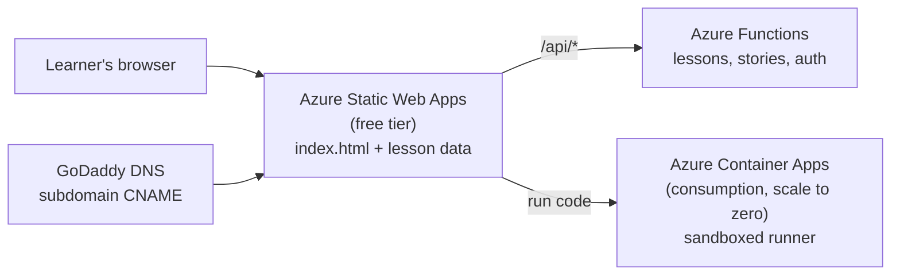

# 09 · Roadmap

## Done ✅

- [x] Python, C#, C++ and Java in one runnable app
- [x] Interest-themed assignments
- [x] Plain-language syntax notes (generated)
- [x] Learning Path: Beginner 100, Intermediate 40, Expert 25
- [x] Mascot (Pip) and personal welcome
- [x] Real-world stories with offline fallback
- [x] Tool Track: Blender, Maya, Houdini, Unity, Unreal (28)
- [x] Four Mini Projects
- [x] Docker packaging and Windows start/stop scripts
- [x] Documentation

## Next (small, high value)

- [ ] Run all C# lessons in Docker and fix any failures
- [ ] Verify Tool Track scripts and Mini Projects on real installs
- [ ] Verify and, if needed, correct the RSS feed URLs
- [ ] Weekly progress summary for the parent ("busy week" friendly)
- [ ] Let the learner design his own mascot art
- [ ] More Intermediate and Expert content (file reading, simple algorithms, vectors)
- [ ] Syntax notes for VEX
- [ ] More Mini Projects (Maya character animation, Film: shot-list generator)
- [ ] Add a `LICENSE` and a short contributing guide before making the repo public

## Later: an online version

Goal: use Code Quest from anywhere (school, iPad) at a custom domain.

| Piece | Choice | Notes |
|---|---|---|
| Front end | Azure Static Web Apps (free) | Custom domain by CNAME at GoDaddy |
| API | Azure Functions | Lessons, stories |
| Code runner | Container Apps, scale to zero | **The risky part** |
| Progress | Browser storage first; optional cloud save later | No accounts needed to start |

### The main risk: running code online

A public code runner can be abused. Before going online it needs:

1. **Authentication**, so only the learner can run code (for example, a login or a secret link).
2. **Isolation** for each run (gVisor, Firecracker, or a short-lived container with no network).
3. **Strict limits** on CPU, memory, time, output size and file access.
4. **No outbound network** from the runner, and rate limits.
5. **Cost caps** and budget alerts in Azure.

Until those exist, the safe choice is the local Docker version.

### Cheaper alternative
Keep the runner local and host only the static pages and stories, so the online part needs no code execution. Code would run on the learner's own laptop.

## Ideas

- A small "show-off" gallery where he can add screenshots of his projects
- Offline cache so the app works with no internet after the first load
- Accessibility checks (contrast, keyboard use, screen readers)
- A "film school" track: automating shot lists, EDLs and render queues with Python
